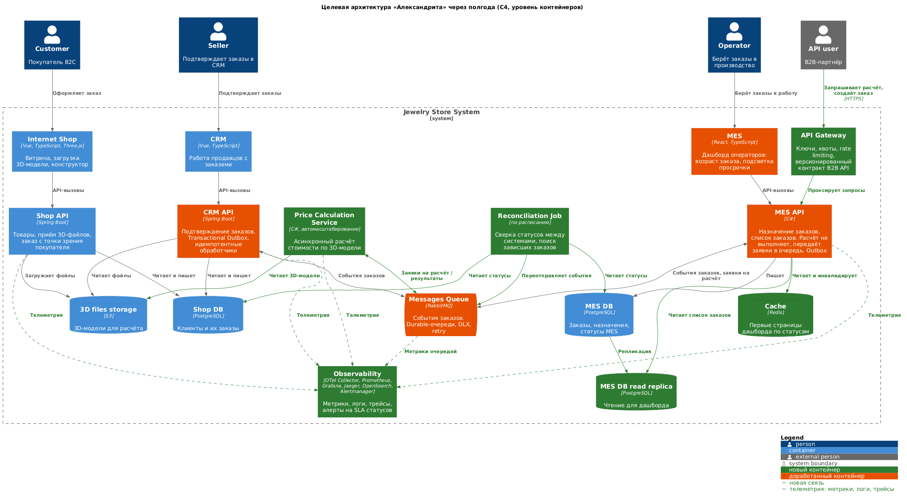

# Планирование: анализ, идентификация проблем и поиск решений

## 0. Исходные данные и допущения

**Что есть сейчас** (по описанию и C4-диаграмме контейнеров):

| Контейнер | Технологии | Роль | Связи |
|---|---|---|---|
| Internet Shop | Vue, TS, Three.js | B2C-витрина, 3D-конструктор | → Shop API |
| Shop API | Spring Boot | товары, приём 3D-файлов, заказ с точки зрения покупателя | → Shop DB, → S3 |
| CRM / CRM API | Vue / Spring Boot | работа продавцов, подтверждение заказов | → **Shop DB** (напрямую), → S3, ↔ RabbitMQ |
| MES / MES API | React / C# (куплен с исходниками) | список заказов, назначение операторов, **расчёт стоимости**, **публичный API для B2B** | → MES DB, → S3, ↔ RabbitMQ |
| RabbitMQ | — | события о новых заказах и смене статусов | CRM ↔ MQ ↔ MES |
| Shop DB, MES DB | Managed PostgreSQL | по одному инстансу на запись и чтение | — |
| 3D files storage | S3 | 3D-модели для расчёта | — |

Каждое приложение — один инстанс (VM). Окружения: dev → release → prod, деплой в release и prod ручной.

**Ключевые факты, влияющие на анализ:**

- Расчёт стоимости: в среднем 2–3 минуты, до 30 минут на сложных моделях. Выполняется в MES API.
- Нагрузка растёт линейно: +100 заказов в месяц к предыдущему месяцу. За полгода — +600 заказов в месяц от текущего уровня, за год — +1200.
- Производственных мощностей хватит на двукратный рост, то есть узкое место — не цех, а ИТ и процессы вокруг заказа.
- После открытия B2B API заказов стало резко больше, а жалоб на просрочку и «потерянные» заказы — ещё больше. Компания уже теряет крупные контракты.

**Допущения** (на схеме не видно, но иначе B2C-процесс не работает):

- Shop API не подключён к RabbitMQ. Значит, о новом B2C-заказе (`SUBMITTED`) MES узнаёт через CRM API: CRM читает Shop DB напрямую (polling или ручное действие продавца) и публикует сообщение в очередь.
- Расчёт стоимости вызывается синхронно внутри MES API, на том же инстансе, что обслуживает дашборд операторов и запросы B2B-клиентов.

---

## 1. Проблемные места

Проблемы сгруппированы по тому, какой симптом бизнеса они объясняют. Важность: **К** — критическая (прямо теряем деньги и клиентов), **В** — высокая, **С** — средняя.

### 1.1. Заказы теряются и «зависают» (жалобы B2C, B2B, потерянные контракты)

| # | Проблема | Почему это проблема | Важность |
|---|---|---|---|
| P1 | **Ненадёжная доставка сообщений через RabbitMQ.** Интеграцию писала своя команда. Нет признаков DLX, повторных попыток, подтверждений публикации (publisher confirms) и ручных ack, идемпотентности обработчиков. | Сообщение, потерянное при сбое или рестарте, обрывает жизненный цикл заказа: статус в одной системе меняется, в другой — нет. Для B2B заказ в CRM **создаётся только из сообщения MES**. Нет сообщения — нет заказа, его никто не подтвердит и не произведёт. Это прямо совпадает с жалобой «не получили заказ». | К |
| P2 | **Нет атомарности «изменение в БД + отправка события».** Сервис коммитит статус в БД и отдельно шлёт сообщение (или наоборот). | Падение между двумя операциями даёт рассинхронизацию CRM, MES и магазина. Восстанавливать это вручную долго, и никто не знает, что нужно восстанавливать. | К |
| P3 | **Нет наблюдаемости.** Нет метрик, централизованных логов, трейсинга и сквозного `correlation_id` в запросах и сообщениях. | Проблемы обнаруживаются только по жалобам клиентов, через недели. Никто не видит, на каком шаге застрял заказ, а разбор каждого случая ведётся «со слов клиента». | К |
| P4 | **Нет контроля SLA по статусам.** Нет таймеров и алертов вида «заказ в `PRICE_CALCULATED` больше N часов без `MANUFACTURING_APPROVED`». | Ручной шаг подтверждения в CRM — потенциальное бутылочное горлышко у продавцов. Растущий поток B2B-заказов копится там незаметно. | В |
| P5 | **Модель мотивации операторов создаёт «голодание» старых заказов.** Операторам платят за взятый заказ, и им важно видеть самые новые. | Сложные или невыгодные старые заказы никто не берёт, они висят месяцами при свободных производственных мощностях. Это объясняет, почему просрочка растёт, хотя цех справляется. | В |
| P6 | **CRM API ходит напрямую в Shop DB** (shared database). | Скрытая связность: изменение схемы в магазине ломает CRM. Нет событий о создании B2C-заказа, есть только polling или ручная выборка. Заказ может «не доехать» до MES. Две системы пишут в одни таблицы, и непонятно, кто владелец статуса. | В |
| P7 | **Жизненный цикл заказа распределён без владельца.** Статус хранится и меняется в трёх системах (Shop DB, CRM, MES DB). Нет единой модели допустимых переходов и нет компонента, отвечающего за заказ от начала до конца. | Возможны недопустимые переходы, «откат» статуса из-за порядка сообщений, расхождение статусов между системами. | С |

### 1.2. Производительность и масштабирование

| # | Проблема | Почему это проблема | Важность |
|---|---|---|---|
| P8 | **Тяжёлый расчёт стоимости (2–30 мин) выполняется в MES API**, на том же инстансе, который обслуживает операторов и B2B-клиентов. | Расчёты съедают CPU и память, и остальные запросы деградируют. Синхронный HTTP-запрос на 30 минут упирается в таймауты балансировщиков и клиентов. Клиент повторяет запрос — получаем дубли расчётов и дубли или пропуски заказов. Пропускная способность одного инстанса ограничена: при последовательной обработке это ~500 средних расчётов в сутки, а со сложными моделями — кратно меньше. | К |
| P9 | **B2B API открыт без шлюза:** нет rate limiting, квот, очереди заявок, асинхронного контракта. Партнёры, вероятно, используют расчёт как «калькулятор» для своих котировок. | Нагрузка на расчёт растёт не пропорционально заказам, а пропорционально запросам цены. Один активный партнёр может положить MES для всех, в том числе для B2C и операторов. | К |
| P10 | **Медленный дашборд операторов в MES.** Фильтр по статусам и пагинация не помогли. | Вероятные причины: конкуренция с расчётами за ресурсы (P8), один инстанс БД на чтение и запись, отсутствие подходящих индексов или OFFSET-пагинация по растущей таблице, отсутствие кеширования. Операторы теряют время и деньги, а самые свежие заказы видны с задержкой. | В |
| P11 | **Единственный инстанс у каждого приложения и каждой БД (SPOF).** | Любой сбой или деплой — простой всей цепочки. Горизонтально масштабировать нечего: нет балансировщика и stateless-подготовки. При линейном росте нагрузки упрёмся в вертикальный потолок. | В |
| P12 | **Нет данных о нагрузке и ёмкости** (следствие P3). | Невозможно спрогнозировать, когда упрёмся в лимиты, и обосновать бизнесу затраты на масштабирование. | В |

### 1.3. Процессы разработки и поставки

| # | Проблема | Почему это проблема | Важность |
|---|---|---|---|
| P13 | **E2E-тестирование только ручное, один QA.** Баг high/highest блокирует весь релиз. | Регресс растёт с каждым спринтом, задержки релиза превышают месяц и продолжают расти. Срочные исправления потерь заказов тоже ждут релизного цикла. | В |
| P14 | **Ручной деплой в release и prod**, нет описанных процедур отката и, судя по всему, нет blue-green или canary. | Рискованные и редкие релизы приводят к большим пачкам изменений и ещё большему риску. | С |
| P15 | **Bus factor по MES = 1.** Один C#-разработчик на критичную купленную систему (плюс тимлид, бывший C#-разработчик, с ограниченным временем). Фронтенд MES на React, а React частично знает только один фронтендер. | Любая доработка MES (а большинство проблем выше — в MES) упирается в одного человека. Отпуск или увольнение останавливает исправления. | В |
| P16 | **MES — купленный код,** экспертизы по его внутреннему устройству мало. | Доработки дороже и рискованнее, чем в своих сервисах. Любое изменение нужно сначала покрыть тестами. | С |
| P17 | **Нет нормального паритета окружений и тестовых данных** для нагрузочного тестирования (одно release-окружение). | Проблемы производительности проявляются только в проде. | С |

### 1.4. Потенциальные проблемы (проявятся при дальнейшем росте)

| # | Проблема | Когда стрельнёт |
|---|---|---|
| P18 | Рост объёма S3 и MES DB без политик хранения и архивации закрытых заказов. | Через 6–12 месяцев: деградация запросов дашборда, рост стоимости хранения. |
| P19 | Нет механизма сверки (reconciliation) статусов между системами. | Даже после исправления P1 и P2 останется «исторический хвост» рассинхронизированных заказов, и новые аномалии никто не найдёт. |
| P20 | Отсутствие версионирования и контракта публичного API. | Любое изменение MES API ломает интеграции партнёров, а это контрактные риски. |
| P21 | Нет управления ёмкостью RabbitMQ (мониторинг глубины очередей, лимиты памяти, кластер). | Один брокер — SPOF. При переполнении памяти RabbitMQ блокирует публикаторов, и встаёт вся интеграция. |

---

## 2. Инициативы

Для каждой инициативы указано, какие проблемы она закрывает.

| # | Инициатива | Что делаем | Закрывает |
|---|---|---|---|
| **I1** | **Наблюдаемость: мониторинг, логирование, трейсинг заказа** | Сквозной `order_id` и `correlation_id` во всех HTTP-запросах и сообщениях. Метрики (Prometheus + Grafana) по RED/USE для API, БД и RabbitMQ, бизнес-метрики (заказы по статусам, время в статусе). Централизованные логи (OpenSearch/ELK). Трейсинг через OpenTelemetry + Jaeger. Алерты на SLA по статусам. | P3, P4, P12, P19 (частично), P21 (частично) |
| **I2** | **Надёжная доставка сообщений** | Durable-очереди и persistent-сообщения. Publisher confirms и ручные ack. DLX с повторными попытками (retry с backoff) и разбором «мёртвых» писем. Идемпотентные обработчики (ключ = `order_id` + `event_id`). Transactional Outbox в CRM API и MES API (и Shop API — см. I6). | P1, P2, P21 (частично) |
| **I3** | **Сверка и восстановление «зависших» заказов** | Ежедневная (затем ежечасная) задача сравнивает статусы в Shop DB, CRM и MES DB, находит расхождения и заказы, которые слишком долго стоят в одном статусе. Создаёт задачи продавцам и операторам или переотправляет событие. Разовый разбор накопленного хвоста. | P19, P4, P1 (последствия) |
| **I4** | **Вынести расчёт стоимости в асинхронный масштабируемый сервис** | Отдельный Price Calculation Worker (код расчёта из MES переносится как есть). Задания идут через очередь RabbitMQ. Пул воркеров в группе ВМ с автомасштабированием по глубине очереди. Приоритеты: B2C и уже оформленные заказы — выше «котировок». MES API принимает заявку и сразу отвечает `202 Accepted` + `calculation_id`. Результат партнёр получает через webhook или polling. | P8, P9 (частично), P10 (частично), P11 (для расчёта) |
| **I5** | **API Gateway для B2B** | Яндекс API Gateway или Nginx/Kong перед MES API: rate limiting и квоты на партнёра, ключи, лимит одновременных расчётов, версионирование `/v1`, OpenAPI-контракт, изоляция внешнего трафика от операторского. | P9, P20 |
| **I6** | **Shop API публикует события сам, CRM уходит из Shop DB** | Shop API пишет событие `OrderSubmitted` через outbox в RabbitMQ. CRM получает заказы из очереди, а данные магазина — через API, а не через чужую БД. | P6, P7 |
| **I7** | **Ускорение дашборда операторов** | Анализ медленных запросов (`pg_stat_statements`), составные индексы под фильтр «статус + дата создания», keyset-пагинация вместо OFFSET. Read-реплика MES DB для чтения. Серверный кеш (Redis) для первой страницы по статусам с инвалидацией по событию смены статуса. Push-обновления (SSE или WebSocket) вместо постоянного обновления страницы. | P10, P18 (частично) |
| **I8** | **Изменение правил распределения заказов** | Совместно с бизнесом: показывать в дашборде возраст заказа и дедлайн, подсвечивать просроченные. Приоритет FIFO по дедлайну. Повышенное вознаграждение за «старые» или сложные заказы либо автоназначение по очереди. Это изменение процесса, ИТ-часть небольшая. | P5 |
| **I9** | **Автоматизация тестирования и CI/CD** | QA строит автотесты E2E по ключевому сценарию заказа (B2C и B2B), интеграционные контрактные тесты для сообщений RabbitMQ, гейт в пайплайне. Автодеплой в release, деплой в prod по кнопке с готовым откатом. Позже — blue-green. | P13, P14, P17 |
| **I10** | **Отказоустойчивость и горизонтальное масштабирование** | Минимум 2 инстанса каждого API за балансировщиком (Yandex Application Load Balancer), stateless-сессии. HA-конфигурация Managed PostgreSQL (реплика + автоматический failover). Кластер RabbitMQ из 3 узлов с quorum queues. В перспективе — Kubernetes (Managed Service for Kubernetes) — см. задание 3.1. | P11, P21 |
| **I11** | **Явная state machine заказа** | Описать допустимые переходы статусов и проверять их в каждом сервисе при получении события. Отклонённые переходы уходят в DLX и вызывают алерт. В перспективе — отдельный Order Orchestrator (saga). | P7 |
| **I12** | **Снижение bus factor по MES и усиление команды** | Наём 1–2 C#-разработчиков (MES — центр большинства изменений: I4, I7, I2) и SRE/DevOps-инженера (наблюдаемость, HA, k8s при одном DevOps). Документирование MES, парное программирование, ADR. | P15, P16 |
| **I13** | **Политики хранения и архивации** | Партиционирование таблицы заказов MES по дате, архив закрытых заказов, lifecycle-правила для S3. | P18 |

---

## 3. Приоритизация

### 3.1. Ход мыслей

Критерии, по убыванию веса:

1. **Влияние на текущие потери бизнеса.** Компания уже теряет крупные контракты из-за «потерянных» и просроченных заказов. Всё, что прямо уменьшает число потерянных заказов, идёт первым.
2. **Видимость.** Без данных мы не знаем, где именно теряются заказы и что тормозит MES. Любая крупная переделка вслепую рискованна, а её эффект нельзя будет доказать бизнесу.
3. **Темп роста нагрузки.** Рост линейный (+100 заказов в месяц), а не взрывной. Есть время на эволюционные изменения, не нужно срочно переписывать всё. Но B2B-нагрузка на расчёт растёт быстрее заказов, поэтому расчёт стоимости — ближайшее узкое место.
4. **Стоимость и риск реализации при текущей команде.** Учитываю, что большинство изменений в MES упирается в одного C#-разработчика (P15).

### 3.2. Матрица «эффект / затраты»

| Инициатива | Эффект для бизнеса | Затраты | Зависимости | Приоритет |
|---|---|---|---|---|
| I1 Наблюдаемость | Высокий (основа для всего остального) | Средние | — | **1** |
| I2 Надёжная доставка сообщений | Очень высокий (прямо закрывает потери заказов) | Средние | лучше после I1 (проверить эффект) | **1** |
| I3 Сверка и восстановление | Очень высокий, быстрый | Низкие | I1 (алерты) | **1 — быстрая победа** |
| I8 Правила распределения | Высокий | Низкие (ИТ) | решение бизнеса | **1 — быстрая победа** |
| I4 Асинхронный расчёт | Очень высокий (B2B, скорость, стабильность MES) | Высокие | I2 (очередь надёжна) | **2** |
| I5 API Gateway | Высокий (защита от перегрузки) | Низкие | — | **2** |
| I7 Ускорение дашборда | Средний–высокий (операторы) | Средние | частично I4 | **2** |
| I12 Наём | Высокий (снимает ограничение по скорости) | Время найма | — | **2 (начать сразу)** |
| I9 Автотесты и CI/CD | Высокий (длинный эффект) | Высокие, но силами QA параллельно | — | **3 (идёт фоном)** |
| I10 HA и масштабирование | Средний сейчас, высокий через 6–12 мес. | Средние–высокие | I1 (знаем ёмкость) | **3** |
| I6 Shop → события | Средний | Средние | I2 | **3** |
| I11 State machine | Средний | Средние | I2 | **4** |
| I13 Архивация | Низкий сейчас | Низкие | — | **4** |

### 3.3. Итоговый порядок

1. **I3 + I8 — быстрые победы (спринты 1–2).** Разбираем текущий хвост зависших заказов: это возвращает доверие ключевых клиентов. Договариваемся с бизнесом о правилах распределения: подсветка просрочки в дашборде — это несколько задач.
2. **I1 — наблюдаемость (спринты 1–4).** Сначала минимальный набор: `correlation_id`, метрики RabbitMQ (DLX, глубина очередей), время заказа в каждом статусе, RED по трём API, централизованные логи. Затем трейсинг.
3. **I2 — надёжная доставка сообщений (спринты 2–5).** С метриками из I1 мы видим, сколько сообщений теряется до и после.
4. **I5 — API Gateway (спринты 3–4).** Дешёвая защита MES от B2B-всплесков, пока идёт I4.
5. **I4 — асинхронный расчёт (спринты 4–9).** Самая крупная и самая ценная техническая переделка.
6. **I7 — дашборд (спринты 6–9).** Индексы и keyset-пагинация можно сделать раньше, как локальную задачу. Кеш и реплика — после I4, когда станет ясно, сколько дал вынос расчёта.
7. **Фоном:** I12 (наём стартует сразу), I9 (QA автоматизирует E2E с первого спринта).
8. **Следующее полугодие:** I10, I6, I11, I13, переход в Kubernetes.

---

## 4. Ответы на вопросы

### 4.1. Целевая архитектура через полгода

Это эволюция текущих контейнеров, а не переписывание. Ключевые изменения:

1. **Внешний периметр.** B2B-клиенты ходят в MES только через **API Gateway**: ключи, квоты, rate limiting, версионированный контракт. Расчёт стоимости в API асинхронный: API сразу принимает заявку, а результат партнёр получает позже, когда расчёт завершится.
2. **Price Calculation Service.** Расчёт стоимости вынесен из MES API в отдельный сервис, который получает задания через очередь и масштабируется под нагрузку. MES API больше не считает сам, а только передаёт заявки на расчёт и принимает результаты.
3. **Надёжная шина событий.** RabbitMQ с durable/quorum-очередями, publisher confirms, ручными ack, DLX + retry. Во всех сервисах-публикаторах (CRM API, MES API) — Transactional Outbox, все обработчики идемпотентны. Каждое сообщение несёт `order_id`, `event_id`, `correlation_id` и `traceparent`.
4. **MES для операторов.** Дашборд читает из read-реплики MES DB через кеш Redis. Индексы и keyset-пагинация, обновления через SSE или WS. Дашборд показывает возраст заказа и подсвечивает просрочку, распределение учитывает дедлайн.
5. **Наблюдаемость.**
   - Prometheus + Grafana: RED для API, USE для ВМ и БД, метрики RabbitMQ, бизнес-метрики заказов.
   - OpenTelemetry Collector + Jaeger: сквозной трейс заказа через Shop → CRM → MQ → MES → Calculation.
   - OpenSearch: централизованные логи.
   - Alertmanager: алерты на SLA статусов, рост DLX, глубину очередей, ошибки.
6. **Сервис сверки (Reconciliation Job).** Периодически сверяет статусы между Shop DB, CRM и MES DB, создаёт задачи или переотправляет события.
7. **Поставка.** Автотесты E2E по основному сценарию заказа в CI как гейт. Автодеплой в release, деплой в prod по кнопке с откатом.
8. **Подготовка к следующему этапу.** Stateless API, конфигурация через переменные окружения, контейнеризация (Docker). Это база для переезда в Managed Kubernetes и горизонтального масштабирования (I10) во втором полугодии.

Что сознательно **не** делаем в первые полгода: распил MES на микросервисы, замену RabbitMQ на Kafka, переписывание CRM. Эффект не оправдывает риск при текущей команде.

Исходник диаграммы в нотации C4 (PlantUML): [target-architecture.puml](target-architecture.puml). Зелёным отмечены новые контейнеры и связи, оранжевым — доработанные контейнеры.

### 4.2. Если можно сделать только три пункта за полгода

**1. Наблюдаемость заказа (I1), с минимальной сверкой статусов из I3 поверх неё.**
Сейчас мы не можем ответить на главный вопрос бизнеса: где застрял конкретный заказ и сколько таких заказов. Без этого:
- нельзя понять, что именно тормозит MES (расчёт, БД, конкуренция за ресурсы), и вместо этого придётся гадать;
- нельзя доказать бизнесу эффект от остальных изменений;
- поддержка продолжит разбирать инциденты «со слов клиента».

Алерты на «заказ дольше N часов в статусе X» и ежедневный отчёт о расхождениях между системами превращают «узнали через два месяца от разгневанного клиента» в «узнали через час и исправили». Это первое, что вернёт доверие B2B-партнёров. Стоимость умеренная, и изменения в основном инфраструктурные. Почти не нужно трогать бизнес-логику купленной MES.

**2. Надёжная доставка сообщений (I2): DLX + retry, publisher confirms и ручные ack, идемпотентность, Transactional Outbox.**
Это прямое устранение самой вероятной причины «потерянных» заказов. B2B-заказ в CRM существует только как сообщение от MES: одно потерянное сообщение — один потерянный заказ и, возможно, потерянный контракт. Интеграцию писала своя команда (CRM на Java, интеграционный код в MES), значит, её можно исправить без глубокого погружения в купленный код. Без этой инициативы любая последующая масштабируемая архитектура (асинхронный расчёт, воркеры) построена на ненадёжном фундаменте.

**3. Асинхронный расчёт стоимости в отдельном масштабируемом сервисе (I4), вместе с минимальным rate limiting на входе B2B API.**
Это корень проблем производительности. Расчёт на 2–30 минут на единственном инстансе MES API:
- тормозит дашборд операторов, потому что делит с ним CPU и память;
- порождает таймауты и повторы у B2B-клиентов, а повторы — это дубли и пропуски заказов;
- ограничивает пропускную способность всей компании пропускной способностью одной ВМ.

Нагрузка на расчёт растёт быстрее числа заказов, потому что партнёры запрашивают цену чаще, чем заказывают. Вынос в воркеры с очередью и автомасштабированием даёт:
- изоляцию: операторы перестают страдать от расчётов;
- горизонтальную ёмкость под рост на годы вперёд;
- корректный асинхронный контракт для партнёров.

Rate limiting (лимит одновременных расчётов на партнёра) добавляется прямо в MES API или на балансировщике за 1–2 задачи и защищает систему, пока воркеры не готовы.

**Почему не другие:**
- **Ускорение дашборда (I7)** частично решится выносом расчёта. Индексы и keyset-пагинацию можно сделать как локальную задачу без отдельного эпика.
- **Автотесты (I9)** — важно, но QA может развивать их параллельно, не отнимая ресурсы у разработчиков. На текущие потери заказов это влияет косвенно.
- **HA и масштабирование (I10)** — рост линейный. Текущие ВМ при выносе расчёта выдержат ещё 6–12 месяцев, а с метриками из I1 мы увидим заранее, когда упрёмся.
- **Изменение правил распределения (I8)** — в первую очередь решение бизнеса, а не ИТ. Предлагаю его руководству параллельно, ИТ-часть минимальна (сортировка и подсветка просрочки).
- **Наём (I12)** — это не задача команды, а решение руководства. Рекомендую параллельно открыть вакансии C#-разработчика (bus factor MES = 1, а инициативы 2 и 3 в основном в MES) и SRE/DevOps (наблюдаемость и инфраструктура при одном DevOps).
