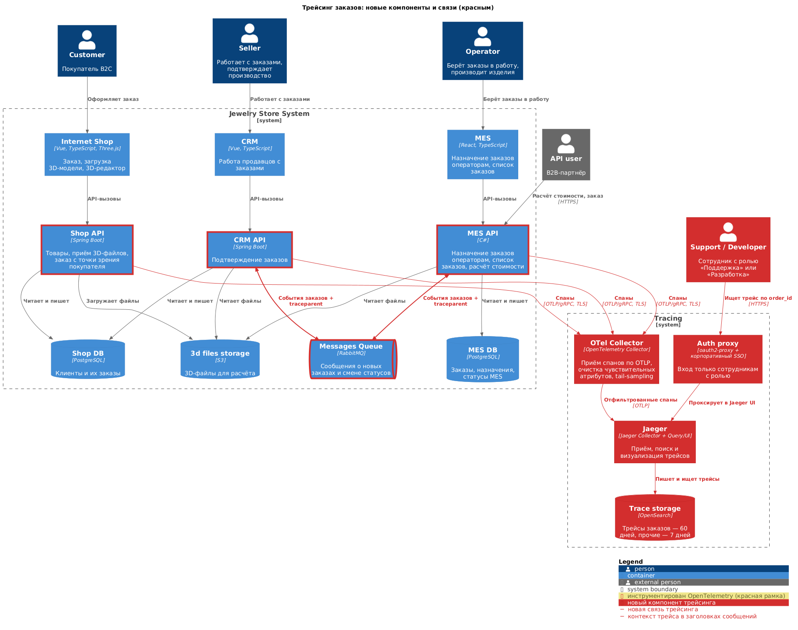
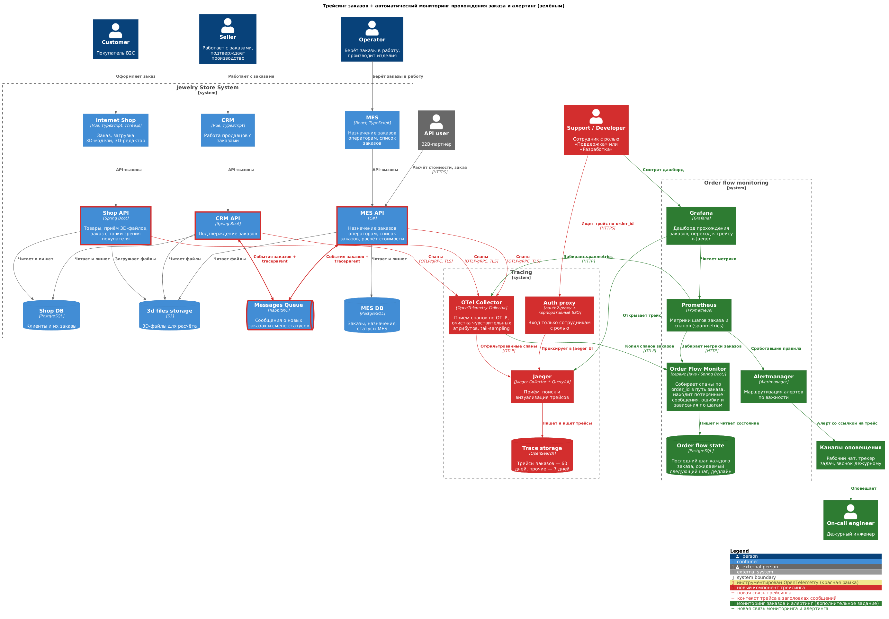

# Архитектурное решение по трейсингу

## 1. Анализ системы в контексте трейсинга

### 1.1. Путь заказа и места, где он может «сломаться» или зависнуть

Заказ проходит через три приложения, две базы данных, S3 и RabbitMQ. Часть шагов автоматические, часть выполняют люди: продавец подтверждает заказ, оператор берёт его в работу.

**B2C-заказ:**

| # | Шаг | Где | Что может пойти не так |
|---|---|---|---|
| 1 | Покупатель загружает 3D-модель и оформляет заказ (`FILE_UPLOADED` → `SUBMITTED`) | Internet Shop → Shop API → S3, Shop DB | Ошибка или таймаут загрузки большого файла в S3. Заказ записан в Shop DB, а файл — нет (или наоборот). |
| 2 | CRM узнаёт о новом заказе | CRM API читает Shop DB напрямую | Нет события о новом заказе: CRM находит его выборкой из чужой БД. Заказ может быть не выбран (ошибка в условии, сбой выборки), и дальше он никуда не уйдёт. Причинная связь между шагами 1 и 2 сейчас теряется. |
| 3 | Передача заказа в MES на расчёт | CRM API → RabbitMQ → MES API | Сообщение не опубликовано (сбой между записью в БД и отправкой). Сообщение потеряно в брокере. Получатель упал или отклонил сообщение, и оно ушло в DLX. У очереди нет получателя. |
| 4 | Расчёт стоимости (`PRICE_CALCULATED`) | MES API, чтение модели из S3 | Расчёт идёт 2–30 минут на единственном инстансе: таймаут, падение процесса, нехватка памяти. Расчёт «завис» или упал, а статус так и не сменился. |
| 5 | Результат расчёта возвращается в CRM и магазин | MES API → RabbitMQ → CRM API → Shop DB | Те же риски, что в шаге 3, плюс: сообщение обработано, но статус в Shop DB не записан. Покупатель не видит цену. |
| 6 | Продавец подтверждает заказ (`MANUFACTURING_APPROVED`) | CRM → CRM API → RabbitMQ → MES API | Ручной шаг: заказ может долго ждать продавца. После подтверждения — риски доставки сообщения, как в шаге 3. Если сообщение потерялось, операторы этого заказа не увидят. |
| 7 | Оператор берёт заказ в работу и выполняет его (`MANUFACTURING_STARTED` → `MANUFACTURING_COMPLETED` → `PACKAGING` → `SHIPPED`) | MES → MES API → MES DB → RabbitMQ → CRM API → Shop DB | Ручной шаг: старые заказы никто не берёт (их вытесняют новые). Каждая смена статуса — сообщение, которое может потеряться, и тогда магазин и CRM показывают устаревший статус. |
| 8 | Закрытие заказа (`CLOSED`) | CRM API (сообщение транспортной компании или вручную) | Сообщение от транспортной компании не пришло или не обработано. |

**B2B-заказ** отличается началом:

| # | Шаг | Где | Что может пойти не так |
|---|---|---|---|
| 1 | Партнёр запрашивает расчёт и создаёт заказ | API user → MES API | Синхронный запрос на минуты: таймауты, повторные запросы партнёра, дубли расчётов и заказов. |
| 2 | Создание заказа в CRM | MES API → RabbitMQ → CRM API | Заказ в CRM существует **только** как это сообщение. Потеря сообщения = потерянный заказ, о котором никто не знает. |
| 3+ | Далее как B2C, с шага 6 | | |

### 1.2. Системы, которые покрываем трейсингом

На схеме (раздел 3.5) они обведены красной рамкой.

| Система | Покрываем? | Почему |
|---|---|---|
| **Shop API** | Да | Вход B2C-заказов, загрузка файлов, запись статусов в Shop DB. |
| **CRM API** | Да | Получает и публикует события заказов, подтверждает заказы, пишет статусы в Shop DB. Через него проходят все заказы. |
| **MES API** | Да | Вход B2B-заказов, расчёт стоимости, смена производственных статусов. Самая проблемная часть. |
| **RabbitMQ** | Да, через заголовки сообщений | Брокер сам спаны не создаёт. Контекст трейса передаётся в заголовках каждого сообщения: так публикация и обработка сообщения попадают в один трейс, а потерянное сообщение становится видно как «публикация без обработки». |
| **Shop DB, MES DB, S3** | Да, со стороны клиента | Это управляемые сервисы. Внутрь не заглянуть, но спаны запросов к ним из приложений показывают, сколько длится запрос и не упал ли он. |
| **Internet Shop, CRM, MES (фронтенды)** | Нет, на первом этапе | См. раздел «Компромиссы». Трейс начинается на входе в API. |

### 1.3. Данные, которые попадают в трейсинг

**Обязательные для каждого спана**:
- `trace_id`, `span_id`, `parent_span_id`, время начала и длительность, статус спана (OK или ERROR);
- `service.name`, `service.version`, `deployment.environment` (dev, release, prod);
- при ошибке — тип исключения и сообщение (без персональных данных), стек вызовов.

**Бизнес-атрибуты заказа** (главное, ради чего внедряется трейсинг):

| Атрибут | Пример | Зачем |
|---|---|---|
| `order.id` | `ORD-2026-004512` | Главный ключ поиска: «покажи всё, что происходило с заказом». Передаётся между сервисами через W3C Baggage, чтобы каждый спан его получил. |
| `order.channel` | `b2c`, `b2b` | Разделение каналов. |
| `order.partner_id` | `partner-17` | Для B2B: какой партнёр. Нужен при разборе жалоб партнёров. |
| `order.status.from`, `order.status.to` | `PRICE_CALCULATED` → `MANUFACTURING_APPROVED` | Какую смену статуса выполнял спан. |
| `order.external_request_id` | идентификатор запроса партнёра | Поиск дублей при повторных запросах партнёра. |

**Атрибуты по типу операции:**

| Операция | Атрибуты |
|---|---|
| Входящий HTTP-запрос | метод, шаблон маршрута (`/orders/{id}`), код ответа, тип клиента (`operator`, `seller`, `customer`, `b2b`) |
| Публикация и получение сообщения RabbitMQ | exchange, routing key, очередь, `messaging.message.id`, тип события (`OrderSubmitted`, `PriceCalculated`, …), признак повторной доставки, число попыток. Для DLX — причина (`rejected`, `expired`, `maxlen`) |
| Запрос к БД | база, операция (`SELECT`, `UPDATE`), таблица. Текст запроса — только с подставленными `?` вместо значений |
| Запрос к S3 | бакет, операция, размер файла. **Без** ключа объекта, если в нём есть данные клиента |
| Расчёт стоимости | число полигонов модели, длительность, результат (успех или тип ошибки). Сама цена в трейс не пишется (коммерческие данные) |

**Что в трейсинг не попадает:** имена, телефоны, e-mail, адреса доставки, платёжные данные, содержимое 3D-файлов, токены и заголовки `Authorization`, тела запросов и ответов.

---

## 2. Мотивация

**Проблема.** Заказы находятся в непонятном состоянии или зависают «где-то внутри». Часть проблем возникает только потому, что теряются сообщения. Сейчас команда разбирает каждый случай вручную: опрашивает клиента, смотрит три базы данных, ищет по логам трёх серверов. Это занимает часы и дни, а иногда причину так и не находят. Тем временем компания теряет крупные B2B-контракты.

**Что даст трейсинг:**
- **Ответ на вопрос «что происходило с заказом и где он сейчас» за минуты.** Поддержка вводит номер заказа и видит хронологию: какие сервисы его обрабатывали, какие сообщения уходили и приходили, где была ошибка и на каком шаге всё остановилось.
- **Видимость потерянных сообщений.** Если сообщение опубликовано, а обработки нет, в трейсе это видно сразу. Сейчас такие случаи невидимы, пока клиент не пожалуется.
- **Видимость медленных мест.** Трейс показывает, на что уходит время: расчёт, запрос к БД, ожидание в очереди. Это база для решений по MES вместо гаданий.
- **Ответы B2B-партнёрам по фактам.** Можно показать, когда пришёл запрос партнёра, что с ним произошло и почему.

**Метрики, на которые повлияет трейсинг:**

| Метрика | Тип | Как изменится |
|---|---|---|
| Время поиска причины проблемы с заказом (MTTR по инцидентам заказов) | Техническая | Сократится с часов и дней до минут: поиск по `order.id` вместо ручного разбора трёх систем. |
| Время обнаружения потерянного или зависшего заказа (MTTD) | Техническая | Вместо недель (жалоба клиента) — минуты (автоматическое обнаружение, см. 3.6). |
| Число заказов, потерянных при передаче между системами | Бизнес | Снижается: каждую потерю видно и можно восстановить заказ, а исправление причины проверяется на трейсах. |
| Доля заказов, выполненных в обещанный срок (3 недели) | Бизнес | Растёт: зависшие заказы находятся до того, как срок нарушен. |
| Число жалоб B2B-партнёров на «не полученные» заказы | Бизнес | Снижается. Остаток жалоб разбирается по фактам, а не со слов клиента. |

---

## 3. Предлагаемое решение

### 3.1. Технологии

| Компонент | Выбор | Почему |
|---|---|---|
| Инструментирование | **OpenTelemetry** (SDK и агенты автоинструментирования) | Открытый стандарт, не привязан к поставщику. Есть готовые агенты для Java (Spring Boot) и .NET (MES): HTTP, JDBC/Npgsql, RabbitMQ-клиент и S3 инструментируются без изменения кода. Тот же стандарт подходит для метрик и логов (задания 2 и 4). |
| Передача контекста | **W3C Trace Context** (`traceparent`) + **W3C Baggage** (`order.id`) | Стандарт, который поддерживают все SDK. Работает и в HTTP-заголовках, и в заголовках сообщений RabbitMQ. |
| Приём и обработка спанов | **OpenTelemetry Collector** | Одна точка, куда сервисы отправляют спаны. В нём удаляются чувствительные атрибуты, выполняется выборка (sampling), спаны направляются в несколько мест. Сервисы не зависят от того, куда в итоге уходят данные. |
| Хранение и UI | **Jaeger** | Open source, зрелый, поиск трейса по атрибуту (`order.id`). Тот же инструмент используется в MVP для Kubernetes (задание 3.1), то есть команда освоит его один раз. |
| Хранилище трейсов | **OpenSearch** | Jaeger поддерживает его как основное хранилище для продакшна. Этот же кластер можно использовать для логов (задание 4), можно взять управляемый сервис Yandex Cloud. |

Рассмотренные альтернативы: Zipkin (беднее поиск и экосистема), Grafana Tempo (дешёвое хранение, но поиск по атрибутам слабее, а он для нас главный), SaaS-решения (данные о заказах уходят во внешний сервис, плюс стоимость растёт с объёмом).

### 3.2. Как устроен трейс заказа

Весь жизненный цикл заказа длится неделями и включает ручные шаги. Один трейс на весь заказ невозможен и бесполезен: Jaeger не рассчитан на трейсы длиной в недели, а между шагами продавца и оператора могут пройти дни.

Поэтому:
1. **Один трейс — один автоматический участок пути заказа.** Например: «покупатель оформил заказ → CRM передал его в MES → MES рассчитал цену → CRM записал цену в Shop DB». Контекст передаётся через HTTP-заголовки и заголовки сообщений RabbitMQ, поэтому вся цепочка попадает в один трейс.
2. **Ручной шаг начинает новый трейс.** Когда продавец нажимает «Подтвердить», начинается новый трейс. Он ссылается на предыдущий через span link: `traceparent` последнего шага сохраняется вместе с заказом в БД.
3. **Все трейсы заказа связаны атрибутом `order.id`.** Поиск в Jaeger по `order.id` показывает все участки пути заказа в хронологическом порядке.

### 3.3. Что нужно внедрить и доработать

**Shop API и CRM API (Java, Spring Boot):**
- подключить Java-агент OpenTelemetry. Он автоматически создаёт спаны для HTTP, JDBC, RabbitMQ и S3 и передаёт контекст в заголовках сообщений;
- добавить в код установку `order.id` в Baggage и атрибуты спана в местах, где известен заказ;
- добавить спан смены статуса заказа с атрибутами `order.status.from` и `order.status.to`;
- Shop API: при оформлении заказа сохранять `traceparent` в строке заказа. CRM API при выборке нового заказа из Shop DB создаёт спан со ссылкой на этот контекст. Так восстанавливается связь шагов 1 и 2, которая сейчас теряется.

**MES API (C#):**
- подключить автоинструментирование OpenTelemetry для .NET (ASP.NET Core, HttpClient, Npgsql);
- добавить передачу контекста в заголовки сообщений RabbitMQ при публикации и извлечение при получении, если используемая версия клиента RabbitMQ не делает этого сама;
- добавить ручной спан «расчёт стоимости» с атрибутами числа полигонов и результата;
- для B2B: не принимать `traceparent` от партнёров (см. «Безопасность»), начинать трейс на входе и возвращать партнёру идентификатор запроса в заголовке ответа. Партнёр сообщает его при обращении в поддержку.

**Обработка DLX:** обработчик очереди «мёртвых» писем создаёт спан с ошибкой и причиной попадания в DLX, связанный с исходным трейсом. Потерянное сообщение будет видно в трейсе заказа.

**Новые компоненты:**
- **OpenTelemetry Collector.** Приём спанов по OTLP, удаление чувствительных атрибутов, выборка, отправка в Jaeger.
- **Jaeger** (Collector + Query/UI) с хранилищем **OpenSearch**.
- **Auth proxy** (oauth2-proxy с корпоративным SSO) перед Jaeger UI: у Jaeger нет собственной аутентификации.

### 3.4. Выборка и хранение

- **Все трейсы, где есть `order.id`, сохраняются целиком.** Заказов сотни в месяц, объём небольшой, а потеря трейса заказа обесценивает весь инструмент.
- **Трейсы с ошибками и медленные трейсы** (дольше 2 секунд, кроме расчёта стоимости) сохраняются целиком.
- **Прочие трейсы** (например, постоянное обновление дашборда операторов) — 10%. Проверки работоспособности (health checks) не сохраняются.
- Решение принимается в Collector после завершения трейса (tail-based sampling), иначе нельзя узнать заранее, будет ли в трейсе ошибка.
- **Хранение:** трейсы заказов — 60 дней (заказ живёт больше трёх недель, а разбор жалобы может начаться позже), остальные — 7 дней.

### 3.5. Схема решения

Новые компоненты и связи трейсинга выделены красным. Инструментированные сервисы и RabbitMQ (через который передаётся контекст) обведены красной рамкой.

Исходник: [diagrams/tracing.puml](diagrams/tracing.puml)

### 3.6. Автоматический мониторинг прохождения заказа и алертинг (дополнительное задание)

Трейсинг сам по себе отвечает на вопрос «что произошло с заказом», когда кто-то спросил. Чтобы проблемы находились **без** вопроса клиента, на данных трейсинга строится автоматический мониторинг.

**Два источника сигналов:**

1. **Агрегированные метрики по спанам (spanmetrics).** Collector из потока спанов считает число вызовов, ошибки и длительность по каждой операции и сервису. Prometheus их забирает. Так видно, например, что доля ошибок при обработке `PriceCalculated` выросла.
2. **Order Flow Monitor** — новый небольшой сервис, который следит за каждым заказом:
   - Collector отправляет ему копию спанов, у которых есть `order.id`;
   - сервис хранит для каждого заказа последний пройденный шаг, ожидаемый следующий шаг и срок, до которого он должен наступить;
   - ожидаемые шаги и сроки описаны моделью жизненного цикла заказа: допустимые переходы статусов и норма времени для каждого.

**Что обнаруживает Order Flow Monitor:**

| Ситуация | Как обнаруживается | Важность | Реакция |
|---|---|---|---|
| Потерянное сообщение | Есть спан публикации сообщения, но за 5 минут нет спана его обработки (по `messaging.message.id`) | Критично | Звонок и сообщение дежурному, в алерте — номер заказа и ссылка на трейс. |
| Сообщение ушло в DLX | Спан обработчика DLX | Критично | Сообщение дежурному с причиной и ссылкой на трейс. |
| Ошибка на шаге заказа | Спан со статусом ERROR и `order.id` | Предупреждение | Тикет в трекере на разбор. |
| Расчёт не завершился | Расчёт начался, но за 45 минут нет результата (максимум — 30 минут) | Предупреждение | Тикет, сообщение в чат команды. |
| Заказ завис на ручном шаге | Превышена норма ожидания: например, `PRICE_CALCULATED` без подтверждения дольше суток, `MANUFACTURING_APPROVED` без взятия в работу дольше двух суток | Предупреждение (бизнес) | Задача ответственной роли (продавцу или старшему оператору). При двойном превышении — уведомление руководителю продаж. |
| Дубль B2B-заказа | Два созданных заказа с одним `order.external_request_id` | Предупреждение | Тикет поддержке: связаться с партнёром. |
| Недопустимый переход статуса | Спан смены статуса, которого нет в модели жизненного цикла | Предупреждение | Тикет команде разработки. |

**Как работает оповещение:**
1. Order Flow Monitor отдаёт метрики: число заказов на каждом шаге, число зависших, потерянных сообщений и т. д. Prometheus их забирает.
2. Правила в Prometheus определяют пороги, Alertmanager маршрутизирует алерты по важности: рабочий чат, трекер задач, звонок дежурному.
3. Каждый алерт по конкретному заказу содержит `order.id` и ссылку на трейс в Jaeger: дежурный сразу видит, где сломалось.
4. В Grafana — дашборд прохождения заказов: сколько заказов на каждом шаге, сколько зависло, время прохождения шагов. С графика можно перейти к конкретному трейсу.

Новые элементы мониторинга и алертинга выделены зелёным, компоненты трейсинга остались красными:

Исходник: [diagrams/tracing_alerting.puml](diagrams/tracing_alerting.puml)

### 3.7. MVP в Kubernetes (задание 3.1)

Два сервиса с трассировкой через OpenTelemetry и Jaeger в Minikube: [k8s-trace/](k8s-trace/), инструкция по запуску — [k8s-trace/README.md](k8s-trace/README.md).

service-a (сервис заказов) вызывает service-b (сервис расчёта). Контекст трейса и `order.id` передаются в HTTP-заголовках (W3C Trace Context и Baggage), так что весь вызов попадает в один трейс. Это тот же механизм, что предложен выше для основной системы.

---

## 4. Компромиссы

| Ситуация | Почему трейсинг здесь не поможет или дорог | Как поступаем |
|---|---|---|
| **MES — купленная система на C#** | Автоинструментирование .NET даёт HTTP- и SQL-спаны без изменения кода. Но передачу контекста через RabbitMQ, атрибут `order.id` и спан расчёта нужно дописывать в чужом коде. Работать с ним может один C#-разработчик, и это конкурирует с другими доработками MES. | Исходный код у компании есть. Начинаем с автоинструментирования. Доработки кода делаем минимальными и точечными, в первую очередь — передачу контекста в сообщениях. |
| **Жизненный цикл заказа длится неделями, с ручными шагами** | Трейсинг показывает технические операции, но не ожидание продавца или оператора. Один трейс на весь заказ невозможен. | Связываем участки через `order.id` и span links. Ожидание на ручных шагах отслеживаем через Order Flow Monitor и бизнес-метрики (задание 2). |
| **CRM читает новые заказы из чужой Shop DB** | Через базу данных контекст не передаётся автоматически. Без доработки связь «заказ оформлен → CRM его подхватил» теряется. | Сохраняем `traceparent` в строке заказа. Правильное решение — события вместо чтения чужой БД (инициатива I6 из задания 1), тогда контекст пойдёт в заголовках сообщения. |
| **Фронтенды** | Трейсинг в браузере усложняет настройку (CORS, отправка спанов из интернета), создаёт риски утечки данных и много шума. Для поиска потерянных заказов он почти не нужен. | Трейс начинается на входе в API. Поведение покупателей в браузере видно в Яндекс Метрике. Вернёмся к вопросу, если будут жалобы на скорость интерфейсов. |
| **Внешние участники: B2B-партнёры, транспортная компания** | Мы не можем заставить их передавать контекст трейса, и не доверяем ему (см. «Безопасность»). | Трейс начинается на нашей границе. Партнёру возвращаем идентификатор запроса для обращения в поддержку. |
| **Управляемые сервисы (PostgreSQL, S3, RabbitMQ)** | Что происходит внутри них, в трейсе не видно. | Достаточно спанов со стороны клиента (длительность, ошибки) и метрик самих сервисов (задание 2). |
| **Ресурсы и стоимость** | Хранилище, Collector и OpenSearch требуют серверов и поддержки, а DevOps-инженер один. Выборка по завершённому трейсу требует памяти в Collector. | Объём небольшой: трейсы заказов сохраняем полностью, остальное — выборочно. Хранилище делим с логированием. Можно взять управляемый OpenSearch. |
| **Потерянное сообщение не создаёт спанов** | Трейсинг показывает только то, что произошло. Если сообщение исчезло, спана обработки просто нет, и в трейсе этого никто не заметит, пока не посмотрит. | Обнаружение «публикации без обработки» — задача Order Flow Monitor (3.6). Устранение причины — надёжная доставка сообщений (инициатива I2 из задания 1). |

---

## 5. Безопасность

Трейсы содержат номера заказов, идентификаторы партнёров и детали внутреннего устройства системы. Утечка не так опасна, как утечка персональных данных, но даёт злоумышленнику карту системы. Поэтому:

**Доступ к Jaeger UI и Grafana:**
- Jaeger UI и Grafana доступны **только из внутренней сети** (или через корпоративный VPN). Наружу не публикуются.
- **Аутентификация через корпоративный SSO** (oauth2-proxy перед Jaeger UI). Войти могут только сотрудники с действующей учётной записью и ролью «Поддержка», «Разработка» или «Эксплуатация». При увольнении доступ отзывается вместе с учётной записью.
- **Разделение окружений:** трейсы prod хранятся отдельно от dev и release. Доступ к prod — только у ролей «Поддержка» и «Эксплуатация» и у дежурного разработчика.
- **Журнал доступа:** входы в Jaeger и Grafana записываются в журнал аудита.

**Приём спанов:**
- Collector принимает данные **только из внутренней сети** (группы безопасности облака разрешают доступ только с адресов сервисов).
- Передача спанов от сервисов в Collector — **по TLS**, сервис предъявляет токен или клиентский сертификат. Так посторонний не сможет записать в систему фальшивые трейсы.

**Данные в трейсах:**
- **В трейсы не пишутся персональные и платёжные данные** (список — в 1.3). Это правило проверяется на ревью кода.
- **Вторая линия защиты — Collector:** он удаляет заголовки `Authorization` и `Cookie`, параметры строки запроса, значения в SQL-запросах, а также атрибуты, похожие на e-mail и телефон, даже если разработчик по ошибке их записал.
- **Хранилище трейсов** шифруется на диске, срок хранения ограничен (60 и 7 дней), после этого данные удаляются автоматически.

**Внешний периметр:**
- **Контекст трейса от B2B-партнёров не принимается.** Если входящий запрос содержит `traceparent` или `baggage`, они игнорируются, и трейс начинается заново. Иначе партнёр мог бы подменить `order.id` в Baggage или «вклеить» свои запросы в чужие трейсы.
- **Наружу не отдаётся ничего, кроме идентификатора запроса.** Партнёры не получают доступ к Jaeger. Если им нужен статус заказа, это задача B2B API, а не системы трейсинга.
