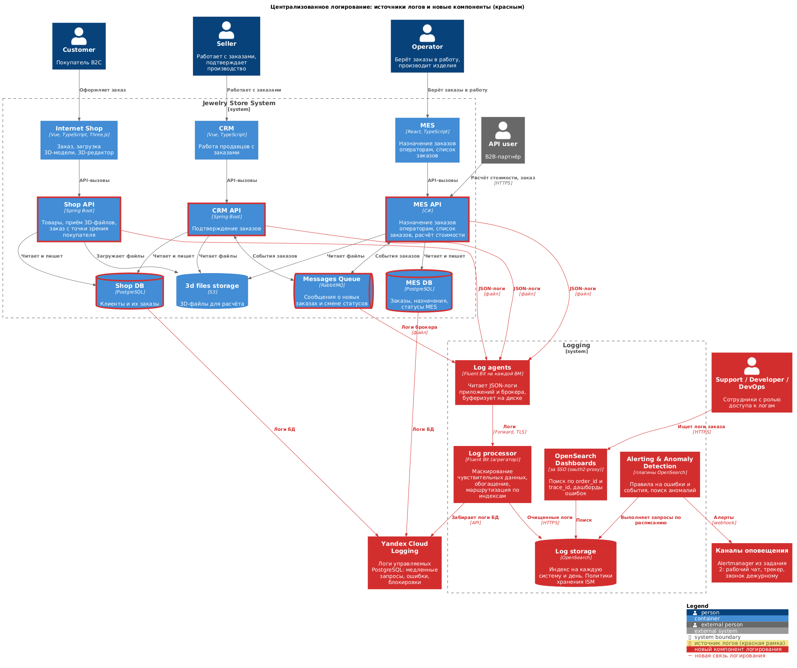

# Архитектурное решение по логированию

## 1. Анализ системы в контексте логирования

### 1.1. Текущая ситуация

Логи пишет каждое приложение на своей ВМ, в своём формате. Единого места, где их можно посмотреть, нет. Поэтому ошибки разбираются со слов клиента: поддержка выясняет, что он делал и когда, а разработчик заходит на нужный сервер и ищет по файлам. Заказ проходит через три приложения и RabbitMQ, поэтому для одного заказа нужно вручную сопоставить записи с трёх серверов, а общего ключа (номер заказа, идентификатор запроса) в записях нет.

### 1.2. Из каких систем собираем логи

На схеме (раздел 3.5) источники логов обведены красной рамкой.

| Система | Собираем? | Какие логи и зачем |
|---|---|---|
| **Shop API** | Да | Бизнес-события B2C-заказов, загрузка 3D-файлов, ошибки. Вход всех B2C-заказов. |
| **CRM API** | Да | Получение и публикация событий заказов, подтверждение заказов продавцами, закрытие заказов, ошибки. Через CRM проходят все заказы. |
| **MES API** | Да | Запросы B2B-партнёров, расчёт стоимости, взятие заказов операторами, смены производственных статусов, ошибки. Самая проблемная часть. |
| **RabbitMQ** | Да | Логи брокера: подключение и отключение клиентов, отмена получателей, срабатывание лимитов памяти и диска. Объясняют, почему сообщения перестали доходить. |
| **Shop DB, MES DB** | Да | Логи управляемого PostgreSQL: медленные запросы, блокировки, ошибки соединений. Нужны для разбора медленного дашборда MES. |
| **3D files storage (S3)** | Нет, на первом этапе | Ошибки работы с S3 видны в логах приложений. Журнал доступа к бакету можно включить позже, если понадобится аудит. |
| **Фронтенды** (Internet Shop, CRM, MES) | Нет, на первом этапе | См. приоритизацию в разделе 2.2. Ошибки в браузере покупателя частично видны в Яндекс Метрике. |

### 1.3. Формат записи

Все приложения пишут логи в **структурированном JSON**, одна запись — одна строка. Обязательные поля каждой записи:

| Поле | Пример | Зачем |
|---|---|---|
| `timestamp` | `2026-10-17T09:15:42.123Z` | Время в UTC, с миллисекундами, чтобы упорядочить события из разных систем. |
| `level` | `INFO` | Уровень. |
| `service`, `env`, `host` | `crm-api`, `prod`, `crm-vm-1` | Откуда запись. |
| `event` | `order.status_changed` | Машиночитаемое имя события: по нему строятся поиск, дашборды и алерты. |
| `message` | `Order status changed` | Описание для человека. |
| `trace_id`, `span_id` | `b1edd428…` | Связь с трейсом в Jaeger (задание 3). Подставляются автоматически агентом OpenTelemetry. |
| `order_id` | `ORD-2026-004512` | Главный ключ поиска: «покажи всё, что происходило с заказом». Пишется во все записи, относящиеся к заказу. |

### 1.4. Логи с уровнем INFO

INFO — это **значимые бизнес-события и события интеграции**. По ним можно восстановить историю заказа без опроса клиента. Кроме обязательных полей из 1.3, каждое событие содержит:

**Shop API:**

| Событие (`event`) | Дополнительные поля |
|---|---|
| Создан заказ (`INITIATED`) | `customer_id` (внутренний идентификатор), `channel=b2c` |
| Загружен 3D-файл (`FILE_UPLOADED`) | `customer_id`, размер файла, формат, длительность загрузки, способ (загрузка или конструктор) |
| Заказ оформлен (`SUBMITTED`) | `customer_id`, число позиций |
| Статус заказа обновлён по данным CRM | `status_from`, `status_to`, источник изменения |

**CRM API:**

| Событие | Дополнительные поля |
|---|---|
| Новый B2C-заказ получен из Shop DB | `customer_id` |
| B2B-заказ создан по сообщению из MES | `partner_id`, `message_id` |
| Сообщение опубликовано в RabbitMQ | `message_id`, тип события, exchange, routing key |
| Сообщение получено и обработано | `message_id`, тип события, очередь, признак повторной доставки, длительность обработки |
| Продавец подтвердил заказ (`MANUFACTURING_APPROVED`) | `seller_id` |
| Заказ закрыт (`CLOSED`) | причина: сообщение транспортной компании или вручную, `seller_id` при ручном закрытии |
| Изменение статуса заказа | `status_from`, `status_to`, кто или что изменило статус |

**MES API:**

| Событие | Дополнительные поля |
|---|---|
| Запрос B2B-партнёра принят | `partner_id`, `external_request_id`, маршрут |
| Расчёт стоимости начат | число полигонов модели, канал |
| Расчёт стоимости завершён (`PRICE_CALCULATED`) | длительность расчёта, число полигонов |
| Оператор взял заказ в работу (`MANUFACTURING_STARTED`) | `operator_id`, возраст заказа на момент взятия |
| Изменение производственного статуса (`MANUFACTURING_COMPLETED`, `PACKAGING`, `SHIPPED`) | `status_from`, `status_to`, `operator_id` |
| Сообщение опубликовано и получено | как в CRM API |

**Для всех API — журнал запросов (access log):** метод, шаблон маршрута, код ответа, длительность, тип клиента (`customer`, `seller`, `operator`, `b2b`), `partner_id` для B2B, IP-адрес. Пишется для каждого запроса, кроме проверок работоспособности.

**RabbitMQ:** подключение и отключение клиентов, создание и удаление очередей, появление и отмена получателей.

### 1.5. Другие уровни логирования

| Уровень | Используем? | Когда |
|---|---|---|
| **TRACE** | Только в dev | Пошаговая отладка. В prod никогда: огромный объём, возможна утечка данных. |
| **DEBUG** | В dev — всегда. В prod — временно | В prod включается точечно для одного сервиса или модуля на время разбора инцидента (в Spring Boot — без перезапуска, через Actuator). Автоматически выключается через 1–2 часа. |
| **WARN** | Да | Нештатная ситуация, которую система обработала сама, но которая может стать проблемой: повторная доставка сообщения, повторная попытка запроса, расчёт дольше 30 минут, медленный запрос к БД, некорректный запрос B2B-партнёра (4xx), использование устаревшей версии API, приближение к лимиту. |
| **ERROR** | Да | Операция не выполнена: необработанное исключение, сообщение отправлено в DLX, не удалось опубликовать сообщение, ошибка записи в БД или S3, расчёт стоимости упал. Всегда с `order_id` (если известен) и стеком вызовов. |
| **FATAL** | Да | Сервис не может работать: не запустился, потерял соединение с БД или брокером без возможности восстановления. Всегда вызывает алерт. |

**Отдельная категория — журнал аудита.** Действия людей, влияющие на заказы и данные: продавец подтвердил или закрыл заказ, кто-то вручную изменил статус, изменены настройки, кто-то просматривал логи. Хранится в отдельном индексе дольше обычных логов, с ограниченным доступом (см. 3.4).

---

## 2. Мотивация

### 2.1. Зачем логирование и что оно даст

**Проблема.** Ошибки разбираются со слов клиента. Чтобы понять, что произошло, разработчику и поддержке нужно много времени: найти нужный сервер, найти файл, сопоставить записи трёх систем по времени. Часть проблем не удаётся разобрать вообще. Разработчики отвлекаются от доработок, поддержка перегружена, а клиенты ждут ответа днями.

**Что даст централизованное логирование:**
- **Поиск всей истории заказа по номеру за минуты.** Записи всех систем в одном месте, связаны `order_id` и `trace_id`.
- **Разбор ошибок без участия клиента.** Видно, что именно произошло, с какой ошибкой и в каком месте кода.
- **Поддержка отвечает сама.** Типовые вопросы («где мой заказ?», «почему не пришла цена?») поддержка закрывает без разработчиков.
- **Проблемы обнаруживаются раньше клиента.** Алерты на ошибки и аномалии (раздел 4).
- **Доказательная база для B2B-партнёров.** Видно, когда пришёл запрос партнёра и что система ответила.

**Логи, метрики и трейсы дополняют друг друга.** Метрики (задание 2) говорят, что что-то не так. Трейсы (задание 3) показывают, где именно в цепочке сервисов. Логи объясняют, что конкретно произошло: какая ошибка, с какими данными.

**Метрики, на которые повлияет логирование:**

| Метрика | Тип | Как изменится |
|---|---|---|
| Среднее время разбора обращения в поддержку | Бизнес | Сократится: поиск по номеру заказа вместо переписки с клиентом и запросов к разработчикам. |
| Доля обращений, закрытых поддержкой без привлечения разработчиков | Бизнес | Вырастет: поддержка сама видит историю заказа и причину проблемы. |
| Время восстановления после инцидента (MTTR) | Техническая | Сократится: причина ошибки видна сразу, не нужно воспроизводить её со слов клиента. |
| Доля инцидентов, обнаруженных до жалобы клиента | Техническая | Вырастет: алерты на ошибки и аномалии в логах. |
| Время разработчиков, потраченное на разбор обращений | Техническая | Сократится и освободится для доработок. |

### 2.2. Что делаем в первую очередь

Команда не сможет одновременно внедрить логирование и трейсинг во всех системах. Порядок определяется тем, где компания теряет больше всего денег и где проблемы сейчас невидимы:

| Очередь | Система | Логирование | Трейсинг | Почему именно так |
|---|---|---|---|---|
| **1** | **MES API + CRM API, обмен через RabbitMQ** | Бизнес-события, публикация и получение сообщений, ошибки | Передача контекста через сообщения, спаны HTTP и БД | Здесь теряются заказы. B2B-заказ в CRM существует только как сообщение от MES, и его потеря означает потерянный контракт. Это главная боль бизнеса. CRM API — свой код на Java, две пары рук, агент OpenTelemetry подключается без изменения кода. MES — купленная система с одним C#-разработчиком, поэтому начинаем с того, что не требует доработок: сбор существующих логов и автоинструментирование, а доработки кода — минимальные и точечные. |
| **2** | **RabbitMQ** (логи брокера) | Да | Не нужен отдельно (контекст идёт в заголовках, см. очередь 1) | Почти бесплатно: только настроить агент на ВМ брокера. Объясняет массовые сбои доставки. |
| **3** | **Shop API** | Да | Да | Вход B2C-заказов. Жалобы B2C тоже растут, но основная потеря денег — в B2B. Код свой, на Java, подключение по той же схеме, что CRM API. |
| **4** | **Shop DB, MES DB** | Медленные запросы, блокировки | Уже есть со стороны клиента (спаны БД из очереди 1) | Нужны для разбора медленного дашборда MES. Включается настройками управляемого сервиса. |
| **5** | **Фронтенды** | Ошибки JavaScript | Отложен | Меньше всего влияет на потерю заказов, а внедрение сложнее: данные приходят из интернета, их нужно защищать и фильтровать. |

---

## 3. Предлагаемое решение

### 3.1. Технологии

| Компонент | Выбор | Назначение |
|---|---|---|
| Формирование логов в приложениях | Java: Logback + `logstash-logback-encoder` (JSON). .NET: Serilog или встроенный `ILogger` с JSON-форматом | Структурированные записи в JSON. `trace_id` и `span_id` подставляются агентом OpenTelemetry (задание 3). `order_id` добавляется в контекст записи (MDC в Java, scope в .NET) в начале обработки запроса или сообщения. |
| Сбор на ВМ | **Fluent Bit** (агент на каждой ВМ) | Лёгкий агент: читает файлы логов, буферизует на диске, если хранилище недоступно, и пересылает дальше. |
| Обработка | **Fluent Bit** (агрегатор) | Вторая линия маскирования чувствительных данных, обогащение (окружение, версия), маршрутизация по индексам. Забирает логи управляемых PostgreSQL из Yandex Cloud Logging. |
| Хранение и поиск | **OpenSearch** (Yandex Managed Service for OpenSearch) | Полнотекстовый поиск, индексы по системам, политики хранения. Тот же кластер, что хранит трейсы (задание 3), но в отдельных индексах. Выбор обоснован в разделе 5. |
| Интерфейс | **OpenSearch Dashboards** за oauth2-proxy с корпоративным SSO | Поиск, сохранённые запросы для поддержки, дашборды. |
| Алерты и аномалии | Плагины **Alerting** и **Anomaly Detection** OpenSearch | Правила по событиям и ошибкам, поиск аномалий. Уведомления — через Alertmanager из задания 2, чтобы все алерты шли по одним каналам. |

### 3.2. Что нужно внедрить и доработать

**Приложения (Shop API, CRM API, MES API):**
1. Перевести логи в JSON с обязательными полями из 1.3 и писать в файл с ротацией.
2. Добавить `order_id` в контекст записей при обработке запроса или сообщения, относящегося к заказу.
3. Добавить INFO-записи о бизнес-событиях из 1.4 там, где их нет. В MES — минимальный набор: смена статуса, расчёт, публикация и получение сообщений.
4. Включить журнал запросов (access log) в JSON.
5. Добавить фильтр маскирования в библиотеку логирования (первая линия защиты, см. 3.4).

**Инфраструктура:**

6. Установить Fluent Bit на ВМ Shop API, CRM API, MES API и RabbitMQ.
7. Развернуть агрегатор Fluent Bit (2 инстанса для отказоустойчивости).
8. Создать индексы, шаблоны индексов и политики хранения в OpenSearch.
9. Включить логирование медленных запросов в Managed PostgreSQL и выгрузку логов в Yandex Cloud Logging.
10. Настроить OpenSearch Dashboards за SSO, роли и права доступа.
11. Настроить правила алертов и детекторы аномалий (раздел 4).

### 3.3. Индексы и политика хранения

**Отдельный индекс под каждую систему и день:** `logs-<service>-<env>-YYYY.MM.DD`. Например, `logs-mes-api-prod-2026.10.17`. Почему так:
- у систем разный объём и разный срок хранения;
- доступ можно ограничить по индексам (например, логи БД — только DevOps);
- старые дни удаляются целыми индексами, без дорогих операций удаления записей.

Журнал аудита и логи окружений dev и release — в отдельных индексах: `audit-prod-*`, `logs-*-dev-*`.

**Сроки хранения (политики Index State Management):**

| Индексы | Горячее хранение (быстрый поиск) | Тёплое хранение | Удаление | Почему |
|---|---|---|---|---|
| Логи приложений prod | 7 дней | до 30 дней | через 30 дней | Большая часть разборов — по свежим событиям. 30 дней покрывают жалобы с задержкой. |
| Бизнес-события заказов (INFO с `order_id`) | 7 дней | до 90 дней | через 90 дней | Заказ идёт больше трёх недель, а жалоба может прийти после доставки. |
| Журнал запросов (access log) | 3 дня | до 14 дней | через 14 дней | Самый большой объём, ценность быстро падает. Агрегаты уже есть в метриках (задание 2). |
| Логи БД и RabbitMQ | 7 дней | до 30 дней | через 30 дней | Как у логов приложений. |
| Журнал аудита | 30 дней | до 1 года | через 1 год | Нужен для разбора спорных ситуаций и проверок безопасности. |
| dev и release | 3 дня | — | через 7 дней | Только для отладки. |
| DEBUG в prod | — | — | через 3 дня | Включается временно, нужен только на время разбора. |

**Оценка объёма.** Это стартовая оценка, её нужно уточнить по фактическим данным первой недели. Допущения: в среднем ~5 запросов в секунду к Shop API, ~1 к CRM API, ~3 к MES API (дашборд операторов и B2B). Средний размер записи ~0,5 КБ, на запрос в среднем 2 записи (журнал запросов + событие).

| Источник | Записей в сутки | Объём в сутки |
|---|---|---|
| Shop API | ~860 тыс. | ~430 МБ |
| CRM API | ~170 тыс. | ~90 МБ |
| MES API | ~520 тыс. | ~260 МБ |
| RabbitMQ, БД | — | ~50 МБ |
| **Итого** | | **~0,8 ГБ** |

С учётом реплики и служебных данных OpenSearch (×~2,2) это ~1,8 ГБ в сутки на диске. С учётом сроков хранения из таблицы выше нужно ~50–60 ГБ. При росте нагрузки на 100 заказов в месяц и с запасом закладываем **150 ГБ** на кластер логов и пересматриваем раз в квартал.

Каждый дневной индекс небольшой (сотни мегабайт), поэтому достаточно **1 основного шарда и 1 реплики** на индекс. Большее число шардов только увеличит накладные расходы.

### 3.4. Безопасность логов

**Работа с чувствительными данными:**
- **В логи не пишутся:** имена, телефоны, e-mail и адреса покупателей, платёжные данные, пароли, токены, ключи API партнёров, содержимое 3D-файлов, тела запросов и ответов целиком. Покупатель, продавец, оператор и партнёр обозначаются только внутренними идентификаторами (`customer_id`, `seller_id`, `operator_id`, `partner_id`). По идентификатору данные можно найти в CRM, где доступ к ним уже контролируется. Так минимизируется обработка персональных данных, которую регулирует 152-ФЗ.
- **Первая линия защиты — в приложении:** фильтр в библиотеке логирования маскирует поля с известными именами (`password`, `token`, `email`, `phone`, `authorization`).
- **Вторая линия — в агрегаторе Fluent Bit:** регулярные выражения находят и маскируют e-mail, телефоны и номера карт, даже если разработчик по ошибке их записал.
- **Проверка на ревью кода:** новый лог проверяется на отсутствие чувствительных данных так же, как сам код.

**Кто имеет доступ (роли в OpenSearch, вход через корпоративный SSO):**

| Роль | Доступ |
|---|---|
| Поддержка | Чтение бизнес-событий заказов и логов ошибок prod (Shop API, CRM API, MES API). Без журнала запросов и логов инфраструктуры. |
| Разработка | Чтение всех логов приложений во всех окружениях. Без журнала аудита. |
| DevOps / Эксплуатация | Чтение всех логов, включая БД и RabbitMQ. Управление индексами и политиками хранения. |
| Безопасность (на старте — тимлид) | Чтение журнала аудита, включая журнал доступа к логам. |
| Все роли | Только чтение. Изменять или удалять записи не может никто, удаление — только по политикам хранения. |

**Дополнительные меры:**
- OpenSearch и Dashboards доступны только из внутренней сети или через VPN.
- Передача логов от агентов к агрегатору и в OpenSearch — по TLS.
- Хранилище шифруется на диске.
- Включён журнал аудита самого OpenSearch: кто какие логи искал и просматривал.
- При увольнении доступ отзывается вместе с корпоративной учётной записью.
- B2B-партнёры доступа к логам не получают.

### 3.5. Схема решения

Источники логов обведены красной рамкой, новые компоненты и связи выделены красным:

Исходник: [diagrams/logging.puml](diagrams/logging.puml)

---

## 4. От сбора логов к анализу логов

Собранные логи сами по себе проблем не решают: их кто-то должен смотреть. Чтобы система работала на опережение, нужны алертинг, поиск аномалий и регулярная работа с данными.

### 4.1. Алертинг по событиям в логах

Правила выполняются в OpenSearch Alerting по расписанию. Уведомления идут через Alertmanager (задание 2), по тем же каналам и уровням важности.

| Правило | Условие | Важность | Реакция |
|---|---|---|---|
| Сообщение отправлено в DLX | Любая запись с этим событием | Критично | Сообщение дежурному с `order_id` и ссылкой на логи заказа. |
| Не удалось опубликовать сообщение | Любая запись с этим событием | Критично | Сообщение дежурному: заказ может быть потерян. |
| Всплеск ошибок | Число ERROR в сервисе за 5 минут в 3 раза выше обычного | Критично | Сообщение и звонок дежурному. Проверить последний релиз. |
| FATAL | Любая запись | Критично | Звонок дежурному. |
| Расчёт стоимости упал | Любая запись об ошибке расчёта | Предупреждение | Тикет. |
| «Тишина» | Нет ни одного события «заказ создан» за 2 часа в рабочее время | Критично | Сообщение дежурному: возможно, приём заказов сломан, но ошибок нет. |
| Новый тип ошибки | Появилась ошибка, которой не было за последние 7 дней | Предупреждение | Тикет команде: чаще всего это последствие релиза. |
| Всплеск 4xx от B2B-партнёра | Доля ошибок 4xx у партнёра выше 20% за 15 минут | Предупреждение | Сообщение менеджеру по работе с партнёром: возможно, у партнёра сломалась интеграция. |

### 4.2. Поиск аномалий

Не все проблемы можно описать заранее правилом с порогом. Плагин Anomaly Detection OpenSearch (алгоритм Random Cut Forest) сам изучает обычное поведение показателя, с учётом времени суток и дня недели, и сообщает о резких отклонениях.

| Что анализируем | Возможная причина аномалии | Реакция |
|---|---|---|
| Число созданных заказов в минуту, отдельно по каналам и B2B-партнёрам | Резкий рост (например, было 4 записи — стало 10 000 в секунду): атака конкурентов, бот, сломанная интеграция партнёра, которая повторяет запросы. Резкое падение: авария. | Немедленное оповещение дежурного и ответственного за безопасность. Временно ограничить запросы от источника на входе (лимиты B2B API, защита от DDoS в облаке). Проверить, не являются ли заказы дублями. |
| Число запросов с одного IP-адреса или от одного партнёра | Перебор, сканирование, DDoS. | Оповещение. Блокировка источника на входе. |
| Доля ошибок по сервисам | Деградация после релиза или сбой зависимости. | Оповещение дежурного. |
| Длительность расчёта стоимости | Аномально сложные модели или деградация MES. | Тикет. |
| Число неудачных попыток входа | Подбор паролей к CRM или MES. | Оповещение ответственного за безопасность. |
| Объём логов от сервиса | Резкий рост: «зациклившийся» код или забытый DEBUG. Падение до нуля: сервис или агент не работает. | Тикет DevOps. |

Детекторам нужно 1–2 недели данных, чтобы изучить обычное поведение. Первое время их срабатывания проверяются вручную, чтобы настроить чувствительность.

### 4.3. Инструменты для ежедневной работы

- **Сохранённый поиск «История заказа»** для поддержки: по `order_id` показывает все записи всех систем в хронологическом порядке. Из записи можно перейти к трейсу в Jaeger по `trace_id`.
- **Дашборды:**
  - ошибки по сервисам и типам;
  - поток бизнес-событий заказов (B2C и B2B);
  - активность и ошибки B2B-партнёров;
  - медленные запросы к БД.
- **Еженедельный разбор:** команда смотрит топ ошибок за неделю и заводит задачи на исправление. Ошибки, которые повторяются, но не исправляются, становятся «нормой», и в них тонут новые.
- **Контроль качества логов:** раз в месяц проверяем, какие записи создают основной объём, но не используются в поиске, и убираем шум. Отдельно проверяем, что маскирование не пропускает чувствительные данные.

---

## 5. Выбор технологии (дополнительное задание)

### 5.1. Сравнение

| Критерий | ELK (Elasticsearch + Logstash + Kibana) | **OpenSearch** (+ Fluent Bit, Dashboards) | Splunk | Grafana Loki | Yandex Cloud Logging |
|---|---|---|---|---|---|
| **Лицензия** | Elastic License 2.0 / SSPL, с 2024 года — также AGPLv3. Часть функций — только в платных подписках | Apache License 2.0, все функции бесплатны | Проприетарная | AGPLv3 | Облачный сервис, оплата по факту |
| **Стоимость** | Бесплатно в базовой версии, но алерты с внешними уведомлениями, ML и детальные права доступа — платные подписки | Бесплатно. Платим только за ресурсы (свои ВМ или управляемый сервис) | Дорого: лицензия зависит от объёма данных в сутки | Дёшево: индексируются только метки, хранение в объектном хранилище | Оплата за объём записанных данных и хранение |
| **Доступность в Yandex Cloud и для компании в РФ** | Управляемый сервис в Yandex Cloud закрыт. Компания Elastic ушла с рынка РФ, поддержка и подписки недоступны | Есть управляемый сервис (Managed Service for OpenSearch) | Ушёл с рынка РФ, покупка и поддержка недоступны | Только самостоятельная установка | Нативный сервис |
| **Алертинг и поиск аномалий** | Алерты есть, ML-аномалии — платно | Встроенные плагины Alerting и Anomaly Detection, бесплатно | Сильные возможности, включая ML | Алерты через правила LogQL и Alertmanager. Встроенного поиска аномалий нет | Базовые возможности, через Yandex Monitoring |
| **Поиск и анализ** | Полнотекстовый поиск, богатый язык запросов | Полнотекстовый поиск, совместим с Elasticsearch, плюс SQL и PPL | Очень мощный язык SPL | Поиск по меткам быстрый, по тексту — перебором, медленнее на больших объёмах | Простые фильтры, анализ ограничен |
| **Безопасность** (роли, права на уровне документов и полей, аудит) | Базовые роли бесплатно, права на уровне документов и полей — платно | Плагин Security: роли, права на уровне индексов, документов и полей, журнал аудита — бесплатно | Полный набор | Мультиарендность по меткам, детальных прав нет | Через роли Yandex Cloud (IAM) |
| **Интеграция с остальной наблюдаемостью** | Jaeger поддерживает Elasticsearch как хранилище | Jaeger поддерживает OpenSearch как хранилище: **один кластер для логов и трейсов** (задание 3) | Отдельная экосистема | Хорошо работает с Grafana и Prometheus (задание 2) | Интеграция с сервисами Yandex Cloud |
| **Требования к ресурсам и эксплуатации** | Высокие: тяжёлый Logstash, нужна экспертиза | Высокие при самостоятельной установке, низкие в управляемом сервисе | Высокие | Низкие | Минимальные |

### 5.2. Выбор: OpenSearch

**Плюсы для «Александрита»:**
- **Всё нужное бесплатно:** алерты, поиск аномалий (прямо требуется для сценария «было 4 заказа — стало 10 000»), права доступа на уровне документов и полей, журнал аудита. В ELK те же функции требуют платной подписки, которую в РФ купить нельзя.
- **Есть управляемый сервис в Yandex Cloud.** Вся инфраструктура компании уже там, а DevOps-инженер один. Управляемый сервис снимает с него обновления, резервное копирование и отказоустойчивость.
- **Один кластер для логов и трейсов.** Jaeger хранит трейсы в OpenSearch (задание 3), поэтому команда осваивает и поддерживает один инструмент, а не два.
- **Полнотекстовый поиск** по сообщениям об ошибках и стекам вызовов, который нужен разработчикам и поддержке.
- **Открытая лицензия** Apache 2.0 без риска её изменения в будущем со стороны одного поставщика.

**Минусы и как с ними работаем:**
- **Требовательность к ресурсам** — дороже Loki при больших объёмах. При наших объёмах (порядка 1 ГБ в сутки) это некритично. Срок хранения ограничен политиками ISM.
- **Нужна экспертиза** в настройке индексов, шардов и политик хранения. Частично решается управляемым сервисом. Остальное — обучение DevOps-инженера и наём SRE (инициатива I12 из задания 1).
- **Экосистема меньше, чем у Elasticsearch.** Но OpenSearch совместим с его API, и большинство инструментов и инструкций подходят.

**Почему не другие:**
- **ELK** — нужные функции платные, а подписки и поддержка в РФ недоступны. Управляемого сервиса в Yandex Cloud нет.
- **Splunk** — дорого и недоступно в РФ.
- **Loki** — хороший кандидат по стоимости и интеграции с Grafana, но слабее в полнотекстовом поиске и не умеет искать аномалии. Вернёмся к нему, если объём логов вырастет на порядок.
- **Yandex Cloud Logging** — подходит как промежуточное звено для логов управляемых сервисов (так и используем его для PostgreSQL), но недостаточен для анализа, алертов и поиска аномалий.
