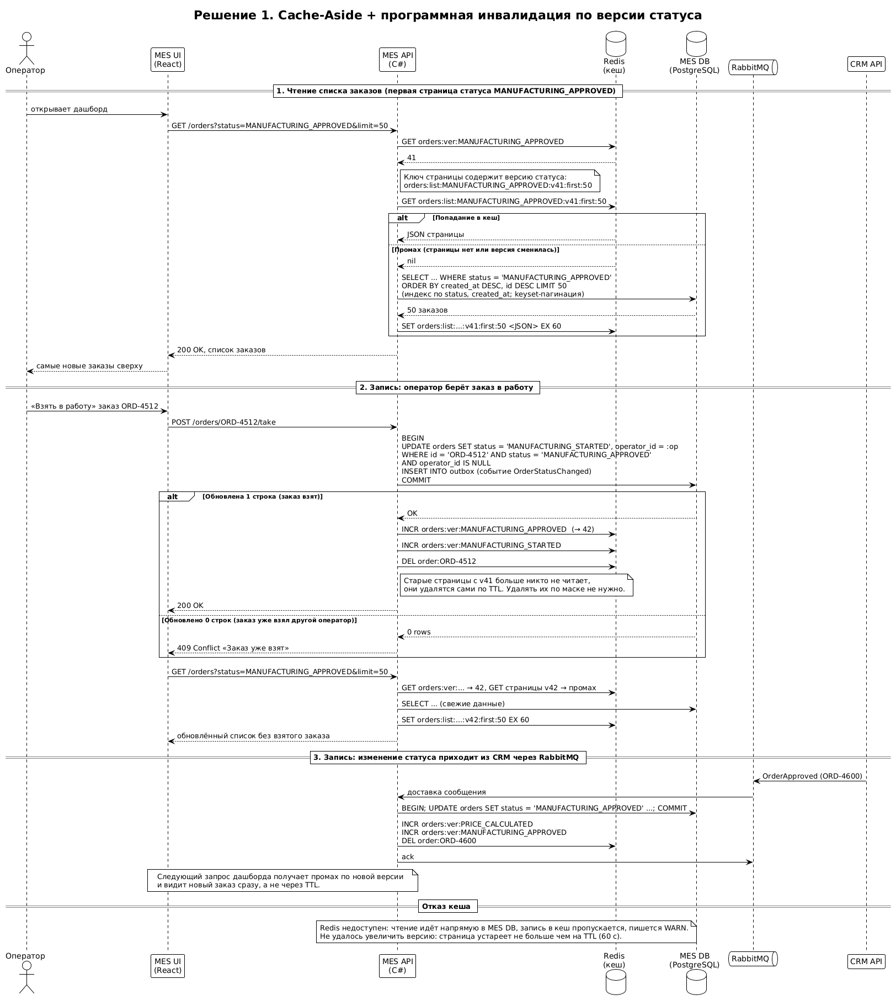
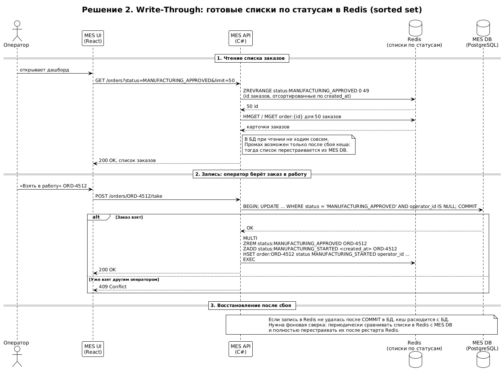

# Архитектурное решение по кешированию

## 1. Анализ: что имеет смысл кешировать

### 1.1. Проблемы

1. **Медленная первая страница MES.** Это дашборд со списком заказов по статусам. Операторы открывают и обновляют его постоянно: им важно первыми увидеть новые заказы, от этого зависит их вознаграждение. Фильтр по статусам и пагинация не помогли.
2. **Новых клиентов не устраивает скорость выполнения заказа.** Первый шаг заказа — расчёт стоимости в MES: 2–3 минуты в среднем, до 30 минут на сложных моделях. Расчёт идёт на том же единственном инстансе MES API, что обслуживает дашборд.

### 1.2. Почему тормозит дашборд

- Каждое открытие и обновление страницы каждым оператором — это запрос к MES DB. Список одинаковый для всех операторов, а запросов много: операторы обновляют страницу, чтобы не пропустить новый заказ.
- MES DB — один инстанс на чтение и запись. Чтения дашборда конкурируют с записью статусов и с работой расчёта стоимости.
- Таблица заказов растёт с каждым месяцем (+100 заказов в месяц к предыдущему месяцу). Пагинация через `OFFSET` и сортировка без подходящего индекса замедляются вместе с ростом таблицы.
- Тяжёлые расчёты на том же инстансе MES API отнимают процессор у запросов операторов.

### 1.3. Что кешируем

| Элемент | Кешируем? | Почему |
|---|---|---|
| **Список заказов по статусам в MES** (первые страницы дашборда) | **Да, основной объект** | Самая частая операция чтения, одинаковый результат для всех операторов, данные меняются реже, чем читаются (заказ меняет статус несколько раз за недели, а дашборд открывают сотни раз в день). Прямо отвечает на жалобу операторов. |
| **Результат расчёта стоимости** по одной и той же 3D-модели | **Да, дополнительно** | B2B-партнёры запрашивают цену для котировок, часто повторно для той же модели. Повторные запросы возникают и после таймаута. Повторный расчёт той же модели — 2–30 минут впустую. Из кеша ответ мгновенный, а мощности MES освобождаются для новых расчётов. |
| Карточка заказа в MES | Да, вместе со списком | Открывается из дашборда. Инвалидируется при той же смене статуса. |
| Статусы заказов в CRM и магазине | Нет | Продавцу и покупателю важна точность, а нагрузка там небольшая. Проблемы со скоростью нет. |
| 3D-файлы | Нет | Уже лежат в S3. Узкое место не в чтении файлов, а в расчёте. |
| Каталог товаров магазина | Нет, в рамках этой задачи | Жалоб нет. При росте B2C — статические данные можно отдавать через CDN. |

**Кеширование — не единственная мера.** Оно снимает повторяющуюся нагрузку чтения, но не устраняет причины. Параллельно нужны:
- **индекс по `(status, created_at)` и keyset-пагинация вместо `OFFSET`** — иначе промах кеша будет таким же медленным, как сейчас;
- **вынос расчёта стоимости в отдельный сервис** (инициатива I4 из задания 1) — иначе расчёты продолжат забирать ресурсы MES API.

---

## 2. Мотивация

**Почему кеширование:**
- **Операторы получают дашборд быстро.** Первая страница статуса отдаётся из памяти за миллисекунды вместо запроса к перегруженной БД. Операторы тратят время на производство, а не на ожидание страницы.
- **Нагрузка на MES DB снижается.** Большинство чтений дашборда больше не доходят до БД. Освободившиеся ресурсы получают запись статусов и расчёт стоимости.
- **Повторный расчёт той же модели не выполняется заново.** B2B-партнёр получает цену мгновенно, MES не тратит минуты процессора на уже посчитанную модель. Новые клиенты получают цену быстрее, потому что очередь расчётов короче.
- **Запас под рост.** Нагрузка растёт линейно, а число запросов к БД от дашборда перестаёт зависеть от числа операторов и частоты обновления.

**Какие проблемы решает:** медленная первая страница MES, конкуренция чтения и записи в MES DB, повторные расчёты одинаковых моделей.

**Какие элементы системы включаем:** MES API (логика кеширования и инвалидации), новый компонент Redis (хранилище кеша), MES DB (источник данных). Изменения точечные, в коде MES API: путь чтения списка, путь смены статуса и обработчик сообщений из RabbitMQ.

---

## 3. Предлагаемое решение

### 3.1. Клиентское или серверное кеширование

| | Клиентское (в браузере оператора) | **Серверное (в MES API + Redis)** |
|---|---|---|
| Что ускоряет | Повторный показ уже загруженных данных конкретному оператору | Все запросы всех операторов |
| Нагрузка на БД | Не снижает: каждый оператор всё равно хотя бы раз запрашивает список, а операторов много | Снижает: один запрос к БД обслуживает всех операторов до следующей смены статуса |
| Актуальность | Плохо: сервер не может сказать браузеру «данные устарели». Оператор видит заказы, которые уже взяли, и пропускает новые. Это напрямую бьёт по его вознаграждению | Хорошо: сервер сам знает, когда изменился статус, и сразу инвалидирует кеш |
| Подходит для расчёта стоимости | Нет: одну и ту же модель считают разные клиенты | Да: результат общий для всех |

**Выбор: серверное кеширование.** Проблема не в том, что браузер повторно скачивает данные, а в том, что сервер и БД обрабатывают одинаковые тяжёлые запросы много раз. Клиентское кеширование этого не решает, а ещё и показывает операторам устаревшие списки в ситуации, где важна каждая минута.

Клиентское кеширование используем только для статики MES (JS, CSS, иконки) — стандартными HTTP-заголовками.

**Хранилище кеша — Redis** (управляемый Redis-совместимый сервис Yandex Cloud):
- общий для всех инстансов MES API, когда их станет несколько;
- поддерживает время жизни ключей (TTL) и атомарный счётчик (`INCR`), на котором построена инвалидация (3.4);
- кеш в памяти процесса MES API не подходит: он не переживает перезапуск и не делится между инстансами.

### 3.2. Паттерн: Cache-Aside

**Как работает для дашборда:**
1. MES API получает запрос списка заказов статуса.
2. Ищет готовую страницу в Redis.
3. **Попадание** — отдаёт страницу из Redis.
4. **Промах** — читает из MES DB (с индексом и keyset-пагинацией), кладёт результат в Redis с TTL и отдаёт.
5. При смене статуса заказа MES API обновляет БД, а затем **инвалидирует** кеш затронутых статусов (3.4). Следующее чтение получит свежие данные из БД.

**Почему Cache-Aside:**
- **Кешируются только реально запрашиваемые данные.** Операторы смотрят первые страницы нескольких статусов. В кеш попадают только они, а не все возможные сочетания статусов, страниц и фильтров.
- **Отказ кеша не ломает MES.** Если Redis недоступен, MES API читает напрямую из БД, как сейчас. Для системы, в которой и так много проблем, это важно: кеш не добавляет новую точку отказа.
- **Минимальные изменения в купленном коде MES.** Логика сосредоточена в двух местах: чтение списка и смена статуса. Это важно, потому что C#-разработчик в команде один.
- **БД остаётся единственным источником правды.** Взятие заказа в работу всегда проверяется в БД атомарным `UPDATE ... WHERE status = ... AND operator_id IS NULL`. Даже если оператор увидел устаревший список, он не сможет взять уже взятый заказ: получит «Заказ уже взят», а список обновится.

**Почему не Write-Through:**
- При Write-Through каждая запись в БД сразу обновляет кеш. Для отдельных объектов это просто. Но дашборд — это **списки**: отсортированные, разбитые на страницы, с фильтрами. Одна смена статуса меняет состав и порядок сразу нескольких страниц двух статусов. Чтобы обновить их при записи, нужно либо пересчитывать все страницы, либо хранить в Redis готовые структуры списков (это решение 2 в разделе 4).
- Запись в БД и в Redis — две разные операции. Если вторая не удалась, кеш расходится с БД и сам не восстанавливается. Нужна отдельная сверка.
- В кеш пишутся данные, которые могут никогда не быть прочитаны: например, изменения статусов, которые операторы не смотрят.

**Почему не Refresh-Ahead:**
- Refresh-Ahead заранее обновляет популярные ключи до истечения их TTL по расписанию. Это помогает убрать задержку промаха, но **не делает данные свежими при изменении**: между обновлениями оператор видит старый список. Сократить интервал до секунд — значит снова постоянно ходить в БД, теряя смысл кеша.
- Обновляет ключи независимо от того, изменились ли данные: лишние запросы к БД в спокойные периоды.
- Для дашборда, где важно увидеть новый заказ сразу, нужна реакция на событие изменения, а не на время. Мы получаем её через инвалидацию при смене статуса.

**Для результатов расчёта стоимости — тоже Cache-Aside:**
1. Перед расчётом MES API вычисляет ключ: хеш содержимого 3D-файла + параметры заказа (материал, размер) + версия прайс-листа.
2. Если результат есть в Redis — сразу возвращает его.
3. Если нет — считает, сохраняет результат с TTL 30 дней и возвращает.

Write-Through здесь не имеет смысла (результат появляется только после расчёта), Refresh-Ahead — тем более (заранее пересчитывать модели на минуты процессора нельзя). **Условие:** расчёт должен быть детерминированным — одна и та же модель с теми же параметрами всегда даёт ту же цену. Это нужно подтвердить с C#-разработчиком до реализации.

### 3.3. Диаграмма последовательности

Чтение списка заказов, запись смены статуса оператором и смена статуса по сообщению из CRM. Участники кеширования:
- **MES API** — читает кеш, при промахе читает БД и заполняет кеш, при смене статуса инвалидирует кеш;
- **Redis** — хранит страницы списков (`orders:list:*`), карточки заказов (`order:*`) и версии статусов (`orders:ver:*`);
- **MES DB** — источник правды;
- **RabbitMQ** и **CRM API** — источник смены статусов, которые приходят из CRM (например, заказ подтверждён продавцом и появляется у операторов).

Исходник: [diagrams/cache_aside_sequence.puml](diagrams/cache_aside_sequence.puml)

**Ключи и время жизни:**

| Ключ | Что хранит | TTL |
|---|---|---|
| `orders:ver:{status}` | Номер версии списка статуса (счётчик) | Без TTL |
| `orders:list:{status}:v{версия}:{курсор}:{размер}` | JSON страницы списка | 60 секунд |
| `order:{id}` | JSON карточки заказа | 5 минут |
| `calc:{хеш файла}:{хеш параметров}:{версия прайс-листа}` | Результат расчёта стоимости | 30 дней |

Кешируем первые страницы (первые 3 страницы каждого статуса). Дальние страницы операторы почти не открывают, им достаточно индекса в БД.

### 3.4. Стратегия инвалидации

**Выбор: программная инвалидация по событию смены статуса через версию ключа + короткий TTL как страховка.**

Как это работает:
- **Для каждого статуса хранится счётчик версии** `orders:ver:{status}`. Версия входит в ключ каждой страницы этого статуса.
- **При смене статуса заказа** с A на B MES API после фиксации транзакции в БД увеличивает счётчики A и B (`INCR`) и удаляет карточку заказа `order:{id}`.
- **Все страницы со старой версией мгновенно перестают читаться**, потому что запросы строят ключ уже с новой версией. Удалять их не нужно: они исчезнут сами по TTL.
- **Смена статуса происходит в двух местах:** в действиях операторов в MES API и в обработчике сообщений из RabbitMQ (статусы из CRM). Оба места — код MES API, поэтому инвалидация срабатывает для всех изменений.
- **TTL 60 секунд — страховка:** если инвалидация не выполнилась (Redis был недоступен в момент записи), устаревшая страница проживёт не дольше минуты.

Почему через версию, а не удалением ключей:
- **Ключей страниц много:** статус × курсор × размер страницы × фильтры. Чтобы удалить их, пришлось бы искать по маске (`SCAN`, это медленно на большом Redis) или хранить список всех ключей. Увеличить версию — одна операция `INCR`.
- **Решается классическая гонка Cache-Aside.** Без версии возможна ситуация:
  1. запрос А получил промах и прочитал старые данные из БД;
  2. запись B обновила БД и удалила ключ;
  3. запрос А записал в кеш старые данные, и они живут до TTL.

  С версией запрос А записывает старые данные под ключом старой версии, который уже никто не читает.

**Сравнение стратегий:**

| | **Программная (по событию, через версию ключа) + TTL** — выбрана | Временная (только TTL) | По ключу (удаление конкретных ключей) | Write-Through-обновление (без инвалидации) |
|---|---|---|---|---|
| Свежесть данных | Новый заказ виден сразу после смены статуса | Задержка до TTL. Оператор видит уже взятые заказы и не видит новые | Сразу, если удалены все затронутые ключи | Сразу |
| Эффективность кеша | Высокая: кеш живёт, пока данные не изменились | Компромисс: короткий TTL — мало попаданий, длинный — устаревшие данные | Высокая | Высокая |
| Сложность | Низкая: `INCR` двух счётчиков в двух местах кода | Минимальная, без изменений кода записи | Высокая для списков: нужно знать все ключи страниц, затронутые изменением | Высокая для списков: нужно пересчитывать страницы (решение 2) |
| Гонка «старые данные записались в кеш после записи» | Исключена: старые данные попадают под устаревшую версию | Есть, ограничена TTL | Есть | Есть при сбоях между записью в БД и кеш |
| Поведение при сбое Redis | Не страшно: TTL ограничивает устаревание минутой, чтение идёт в БД | Не страшно | Ключ не удалён — устаревшие данные до TTL | Кеш расходится с БД, нужна сверка |
| Подходит для дашборда | **Да** | Нет: операторам важна каждая минута | Частично: для карточки заказа да, для списков сложно | Возможно, но дороже (см. раздел 4) |

**Для карточки заказа** используется инвалидация по ключу: при смене статуса удаляется ровно один ключ `order:{id}`, это просто.

**Для результатов расчёта** — инвалидация по ключу через версию прайс-листа: при изменении тарифов меняется версия, новые запросы идут мимо старых результатов. Плюс TTL 30 дней, чтобы старые результаты не копились.

---

## 4. Альтернативное решение и сравнение (дополнительное задание)

### 4.1. Решение 2: Write-Through в готовые списки Redis

Вместо кеширования готовых страниц в Redis хранятся **сами списки заказов по статусам**:
- для каждого статуса — сортированное множество (`sorted set`) идентификаторов заказов с датой создания в качестве веса;
- для каждого заказа — карточка (`hash`).

При смене статуса MES API после записи в БД атомарно переносит заказ из множества старого статуса в множество нового и обновляет карточку (Write-Through). Чтение страницы — выборка первых N элементов множества и их карточек, без обращения к БД.

Исходник: [diagrams/write_through_sequence.puml](diagrams/write_through_sequence.puml)

### 4.2. Сравнение

| | Решение 1: Cache-Aside + инвалидация по версии | Решение 2: Write-Through в списки Redis |
|---|---|---|
| **Описание решения и его диаграмма** | Готовые страницы кешируются при первом чтении. Смена статуса увеличивает версию — страницы перестраиваются из БД при следующем чтении. Диаграмма: 3.3 | Списки по статусам постоянно поддерживаются в Redis при каждой смене статуса. Чтение идёт только из Redis. Диаграмма: 4.1 |
| **Плюсы решения** | Простая реализация: несколько мест в коде MES. Отказ Redis не ломает MES — чтение идёт в БД. БД — единственный источник правды, рассинхронизация невозможна дольше TTL. Нет отдельной процедуры восстановления. | Чтение никогда не идёт в БД, даже после смены статуса: стабильно быстрое время ответа. Любая страница, не только первые, отдаётся из Redis. Хорошая основа для обновления дашборда в реальном времени (push операторам при смене статуса). |
| **Минусы решения** | После каждой смены статуса первый запрос получает промах и идёт в БД. При частых сменах статусов попаданий меньше. Скорость промаха зависит от индексов в БД. | Двойная запись в БД и Redis: при сбое между ними кеш расходится с БД и сам не восстанавливается. Нужны фоновая сверка и полная перестройка списков после рестарта Redis. Больше кода в купленной MES. Redis становится обязательным для работы дашборда. Больше памяти: хранятся все заказы активных статусов. |
| **Сложность для команды** | Низкая | Высокая |
| **Когда выбирать** | Сейчас: при текущих объёмах и одном C#-разработчике | Если смен статусов станет так много, что попадания в решении 1 станут редкими, или понадобится обновление дашборда в реальном времени |

### 4.3. Заключение

**Выбираем решение 1: Cache-Aside с программной инвалидацией по версии статуса и коротким TTL**, вместе с индексом по `(status, created_at)` и keyset-пагинацией в MES DB.

Почему:
- **Решает проблему операторов.** Первые страницы отдаются из памяти, новый заказ виден сразу после смены статуса.
- **Безопасно для системы, в которой и так много проблем.** Отказ кеша не ломает MES, а БД остаётся единственным источником правды. Решение 2 добавило бы ещё одну двойную запись — именно этот тип ошибок уже приводит к потерянным заказам (задание 1).
- **Реалистично для команды.** Изменения точечные, в двух местах кода MES, их может сделать один C#-разработчик.
- **Эффект можно проверить.** Доля попаданий в кеш, время ответа дашборда и нагрузка на MES DB отслеживаются метриками из задания 2. Если доля попаданий окажется низкой из-за частых смен статусов, переходим к решению 2 — ключи и Redis уже будут на месте.

Дополнительно кешируем результаты расчёта стоимости по хешу модели: это снижает нагрузку на MES и ускоряет ответ B2B-партнёрам при повторных запросах. Внедряем после того, как C#-разработчик подтвердит, что расчёт детерминирован.
